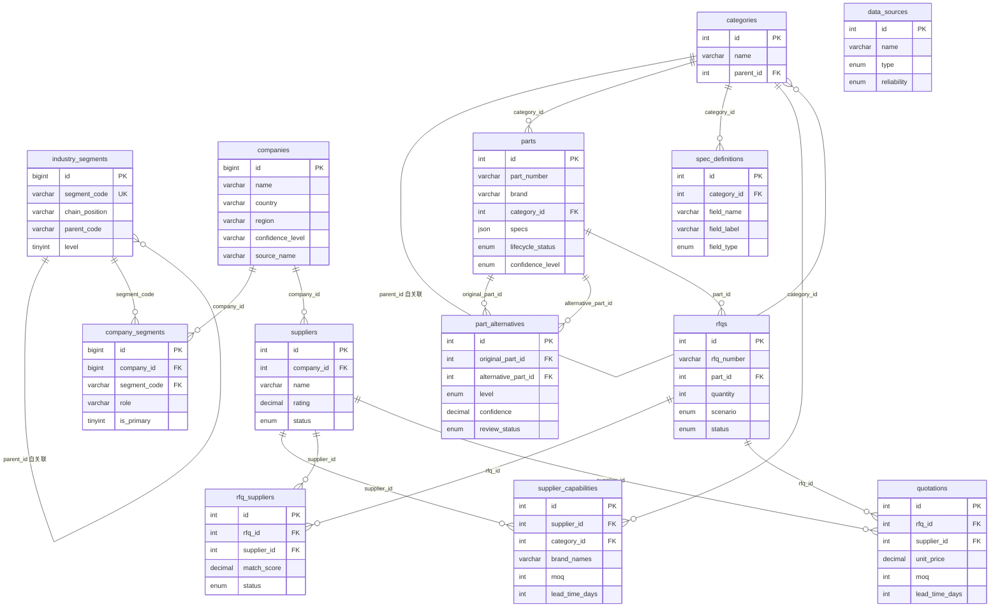

# 03 - ER 关系图（1-3h 核心表设计交付）

> 数据库：`pc_industry` · 13 张核心表
> 业务闭环：`需求 -> 物料 -> 替代料 -> 供应商 -> RFQ -> 报价`

## 1. 实体关系（Mermaid）



## 2. 关键关系说明

| 关系 | 父表 → 子表 | 外键 | 业务含义 |
|---|---|---|---|
| 产业环节层级 | industry_segments → industry_segments | parent_code | 上游/中游/下游/支撑，按 chain_position + parent_code 组织 |
| 公司属于环节 | companies / industry_segments → company_segments | company_id, segment_code | 一家公司可跨多环节（如 Foxconn 既 ODM 又 EMS） |
| 公司关联供应商 | companies → suppliers | company_id | 供应商主体可关联网内公司（分销商门店 vs 公司总部） |
| 品类层级 | categories → categories | parent_id | MLCC → 0603 MLCC 等子品类 |
| 物料属于品类 | categories → parts | category_id | 物料归属品类 |
| 品类规格定义 | categories → spec_definitions | category_id | 每个品类定义结构化规格字段 |
| 替代关系 | parts → part_alternatives (×2) | original_part_id, alternative_part_id | 物料两两替代，带 L1-L5 等级 |
| 供应商能力 | suppliers / categories → supplier_capabilities | supplier_id, category_id | 供应商在某品类的覆盖品牌/MOQ/交期 |
| RFQ 目标物料 | parts → rfqs | part_id | 询价单锁定目标物料 |
| RFQ 目标供应商 | rfqs / suppliers → rfq_suppliers | rfq_id, supplier_id | 询价推送给多个供应商 |
| 报价 | rfqs / suppliers → quotations | rfq_id, supplier_id | 供应商对 RFQ 回复报价 |

## 3. 数据来源溯源链

```
data_sources(1) ──┐
                  ├──> companies.confidence_level / source_name / source_url
                  ├──> parts.confidence_level / source_name / source_url
                  ├──> part_alternatives.source_name / source_url / review_status
                  └──> suppliers / supplier_capabilities.source_name
```

> `data_sources` 表独立登记来源（官网/行业报告/现货商城/内部），
> 各业务表用 `source_name` + `source_url` + `confidence_level` 冗余溯源，
> 不强制外键，保证录入灵活性。`confidence_level` 枚举对齐 NAMING_CONVENTIONS.md §6。

## 4. 与 matchforge 库的字段映射（收敛方向）

| pc_industry | matchforge | 收敛说明 |
|---|---|---|
| companies | enterprises | pc_industry 用 companies + industry_segments 表达产业链；matchforge 用 enterprises(buyer/supplier) |
| parts | products | pc_industry 拆出 spec_definitions；matchforge 用 products.specs JSON |
| suppliers | suppliers | 字段基本一致，pc_industry 多 company_id 关联 |
| supplier_capabilities | (无) | matchforge 用 products 行表达供应能力；pc_industry 拆出能力表 |
| part_alternatives | (Neo4j EQUIVALENT_TO) | pc_industry 用关系表 + level；matchforge 用 Neo4j 图 |
| rfqs | rfqs | pc_industry 多 scenario/目标价；matchforge 多 thread_id/AI 中间态 |
| rfq_suppliers / quotations | (无) | pc_industry 补全 RFQ→报价闭环 |

> 长期收敛：以 pc_industry 为产业链事实源，matchforge 的 AI 寻源会话通过 part_id / supplier_id 外键引用 pc_industry，见 [06_handoff/01_retrospective.md](../06_handoff/01_retrospective.md)。
